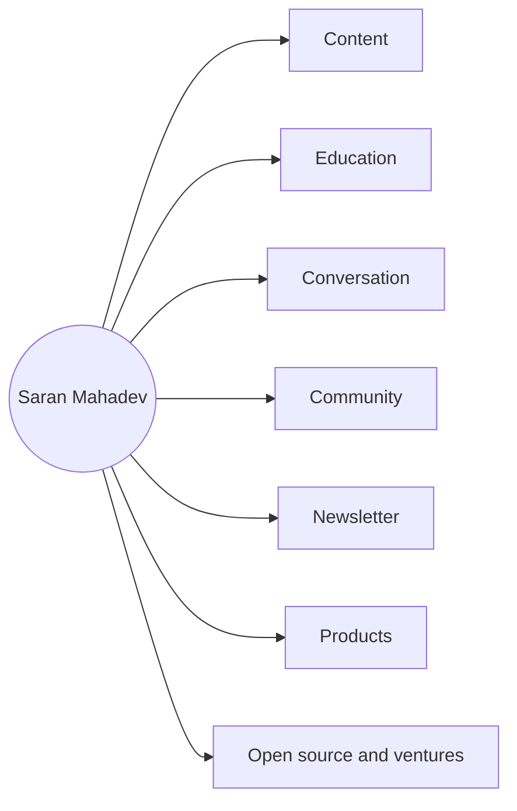

**Learning, creating, teaching, sharing and building should not be separate activities.**

Dev Universe is the system around my work. At the center is me, Saran Mahadev, and around me sits a set of connected parts: content, education, conversation, community, a newsletter, products, open source and ventures. Each one feeds the others.

This is a map of what I am building, and much of it is still an idea. So the first thing below is an honest overview of what is live today and what is not.

## The map at a glance

*Dev Universe: seven layers around one center*

| Layer | Part | Its job | Status |
| --- | --- | --- | --- |
| Content | Drafted | Deep thinking and written knowledge | Live |
| Content | YouTube | Learn, build and share | Live |
| Content | Everything.by.Dev | Discovery across the whole ecosystem | Live |
| Content | Lyf as Dev | The personal side: how I live | Live |
| Education | Scratch with Dev | Complete learning paths | Idea |
| Education | Dev Workshops | Live and in-person teaching | Idea |
| Conversation | Vazhviyal | Learning about life from interesting people | Idea |
| Community | Dev Den | The community home, on Discord | Idea |
| Community | r/discusswithdev | Open public discussion | Idea |
| Newsletter | Dev Universe Weekly | One digest for everything | Idea |
| Products | shop.saranmahadev.in | Helping people execute | Idea |
| Open source | AI Library | An open AI knowledge layer | Idea |
| Open source | Inflate AI | The open-source engineering arm | Idea |
| Education | InflateEd | Selective mentorship, starting with Super 40 | Idea |
| Ventures | Inflate Ventures | One organizational umbrella | Idea |

## Content: the media layer

Content is the entry point. Each platform has its own purpose, instead of the same material being posted everywhere.

### Drafted

[Drafted](/) is the writing and thinking layer, where ideas are developed in written form: software engineering, AI and technology, productivity, systems, entrepreneurship, careers, project lessons, experiments and long-form technical writing.

**Its job: deep thinking and written knowledge.**

### YouTube

[Saran Mahadev on YouTube](https://www.youtube.com/@saranmahadev) is the main public-facing channel. It covers technology, AI, software engineering, productivity, business, projects, experiments, tutorials, long-form videos and Shorts.

**Its job: learn, build and share.**

### Everything.by.Dev

[Instagram](https://www.instagram.com/everything.by.dev) is the discovery and distribution layer. Rather than being another personal account, it is a feed of what is happening across Dev Universe: new videos, articles, courses, workshops, podcast episodes, products, community updates and discoveries.

## The personal layer

Not everything needs to be educational or technical.

### Lyf as Dev

[Lyf as Dev](https://www.instagram.com/lyf.as.dev) is where the personal side lives: vlogs, casual conversations, travel, behind-the-scenes content, experiments, failures, thoughts and everyday life.

The distinction is intentionally simple.

| Saran Mahadev | Lyf as Dev |
| --- | --- |
| What I know and build. | Who I am and how I live. |

That gives Dev Universe room for both expertise and personality.

## Education: turning knowledge into learning

Content can teach one concept. Education goes further by creating structured learning experiences.

### Scratch with Dev

The course and structured-learning brand. Its potential areas include programming, software engineering, AI engineering, computer science, system design, developer tools, agent engineering, production engineering and practical software development.

**Learn from scratch. Build practically. Understand deeply.**

YouTube can introduce ideas and create awareness, while Scratch with Dev offers complete learning paths.

### Dev Workshops

Workshops sit between content and formal education: live technical workshops, corporate training, college workshops, developer bootcamps, community sessions, and offline programs at colleges, universities, companies, conferences and events.

## Conversation: learning from people

### Vazhviyal

Vazhviyal takes the ecosystem beyond technology. The concept is to explore life through conversations with interesting people, across technology, entrepreneurship, science, careers, finance, creativity, psychology, education, relationships, leadership, failure, philosophy, culture and personal journeys.

The aim is not just to interview successful people. It is to spend meaningful time with interesting people and understand what they know about life.

## Community: from audience to network

Content creates an audience. Community turns that audience into people who talk to one another.

### Dev Den

Dev Den is envisioned as the community home on Discord, with spaces for software engineering, AI, projects, careers, productivity, entrepreneurship, open source, courses, workshops and events. Over time it could support study groups, project groups, mentorship, hackathons, peer learning, job discussions and build-in-public groups.

### r/discusswithdev

Reddit is the public discussion layer. Where Dev Den is the community home, Reddit offers a more open place for questions, debates, project showcases, technical problems and community-made knowledge.

## Dev Universe Weekly: connecting everything

The newsletter is the single subscription point for the whole ecosystem. Rather than another separate stream of content, it can be a weekly digest of everything below.

| Made | Offered | Shared |
| --- | --- | --- |
| What was written | New courses | Community highlights |
| What was published | Upcoming workshops | Open-source releases |
| What was learned | New Vazhviyal episodes | |
| What was built | New products | |
| Interesting discoveries | | |

That gives the different parts of Dev Universe one central thread.

## Products: helping people execute

### shop.saranmahadev.in

The product layer turns knowledge into things people can actually use. Potential products include templates, developer tools, Notion and Obsidian systems, productivity systems, engineering and AI resources, e-books, guides, checklists, code, courses, toolkits and, eventually, SaaS products.

> Content teaches. Products help people execute.

## AI Library: an open knowledge layer

The AI Library is a major long-term idea: a high-quality, open-source learning platform where people can learn AI, follow structured learning paths, study implementations, explore examples, contribute knowledge, build projects, discover tools and track their learning.

The philosophy behind it: open knowledge should be structured, understandable and continuously improved by the community. Over time it could grow beyond articles into community-maintained AI knowledge infrastructure.

## Open source and ventures

The ecosystem also has a path from ideas to organizations.

1. **Ideas.** Where everything starts.
2. **Experiments.** Small tests of whether an idea is worth more.
3. **Software.** The experiments that survive become real tools.
4. **Organizations.** The work that grows gets a home.

### Inflate AI

The open-source engineering arm. It can house developer tools, AI tools, agent infrastructure, productivity software, frameworks, research projects, developer infrastructure and community projects.

**Its principle: do not build because we can. Build because it is worth building.**

### InflateEd

The high-touch education and mentorship layer. Its first concept, Super 40, is a selective cohort of about 40 people, helping highly motivated individuals become much better builders through mentorship, technical training, projects, industry exposure, open source, career guidance and an alumni network.

### Inflate Ventures

Inflate Ventures Private Limited is the organizational umbrella that brings the ventures under one roof.

## In essence

Dev Universe is the system around my work. It brings together everything I care about doing:

**Learn, think, create, share, teach, build, collaborate, productize and give back.**
